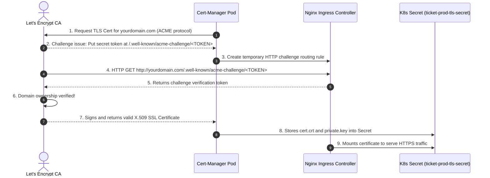
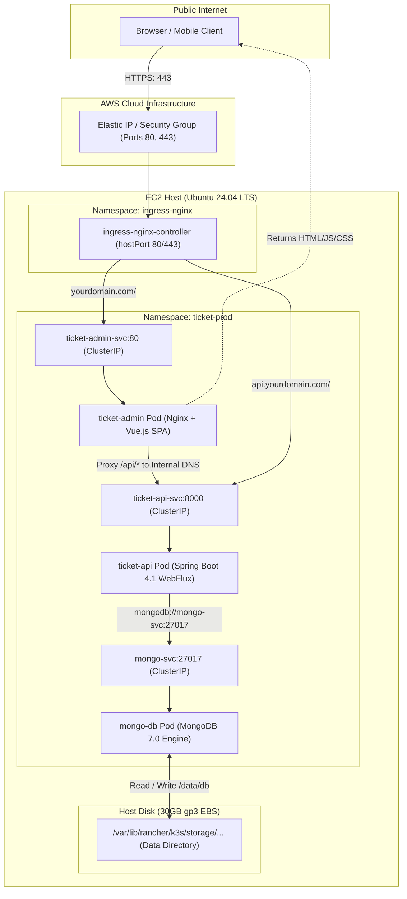

# Deep Dive: Kubernetes Architecture on a Single AWS EC2 Server

> A comprehensive, production-grade explanation of how Kubernetes (K3s), nodes, pods, services, namespaces, and networking interact inside a single AWS EC2 virtual machine.

---

## Table of Contents
1. [Physical & Virtual Infrastructure Layer (AWS EC2)](#1-physical--virtual-infrastructure-layer-aws-ec2)
2. [Kubernetes Control Plane & Worker Architecture (K3s)](#2-kubernetes-control-plane--worker-architecture-k3s)
3. [Namespaces: Logical Cluster Segmentation](#3-namespaces-logical-cluster-segmentation)
4. [Compute Hierarchy: Node → Pod → Container](#4-compute-hierarchy-node--pod--container)
5. [Kubernetes Networking & Service Discovery](#5-kubernetes-networking--service-discovery)
6. [Ingress & SSL Traffic Lifecycle](#6-ingress--ssl-traffic-lifecycle)
7. [Storage Architecture: Persistent Volumes & Local-Path](#7-storage-architecture-persistent-volumes--local-path)
8. [End-to-End Packet Flow (User to MongoDB)](#8-end-to-end-packet-flow-user-to-mongodb)
9. [Resource Constraints & Survival on a 1 GB RAM Node](#9-resource-constraints--survival-on-a-1-gb-ram-node)

---

## 1. Physical & Virtual Infrastructure Layer (AWS EC2)

Before Kubernetes enters the picture, understanding the underlying host machine is essential. We operate on a single **AWS EC2 `t3.micro`** virtual machine running Ubuntu 24.04 LTS:

```text
┌─── AWS Cloud VPC (Virtual Private Cloud) ───────────────────────────────────────────┐
│                                                                                     │
│  [ Elastic IP: Public IPv4 (e.g., 54.x.x.x) ]                                       │
│                         │                                                           │
│                         ▼                                                           │
│              [ AWS Security Group ]                                                 │
│              - Port 22  (SSH Administration)                                        │
│              - Port 80  (HTTP / ACME Challenge)                                     │
│              - Port 443 (HTTPS Production Traffic)                                  │
│              (All other ingress ports DROP by default)                              │
│                         │                                                           │
│                         ▼ eth0 (Private IP: 172.31.x.x)                             │
│  ┌─── EC2 Virtual Machine Host (Ubuntu 24.04 LTS) ───────────────────────────────┐  │
│  │                                                                                │  │
│  │  Hardware Specs:                                                               │  │
│  │  - CPU: 1 vCPU (burstable baseline + CPU credits)                              │  │
│  │  - Physical RAM: 1024 MiB (1.0 GiB)                                            │  │
│  │  - Virtual Memory: 2048 MiB Linux Swap File (/swapfile on gp3)                │  │
│  │  - Total Addressable Memory: ~3072 MiB                                         │  │
│  │  - Storage: 30 GiB gp3 EBS volume mounted at / (Root Filesystem)               │  │
│  │                                                                                │  │
│  │  Host OS Subsystems:                                                           │  │
│  │  - Linux Kernel 6.8+ (cgroups v2, namespaces, iptables/nftables)               │  │
│  │  - systemd (init system & service supervisor)                                  │  │
│  │                                                                                │  │
│  └────────────────────────────────────────────────────────────────────────────────┘  │
└─────────────────────────────────────────────────────────────────────────────────────┘
```

### Key Hardware Facts for this Architecture:
* **The "Bare-Metal" Feeling**: You don't have a managed cloud Kubernetes control plane (like AWS EKS). You run the master and worker on the same Linux operating system.
* **Network Interface (`eth0`)**: The VM has an internal IP in the VPC subnet (`172.31.x.x`). The AWS gateway performs 1:1 NAT mapping between your public **Elastic IP** and this private interface.
* **Burstable CPU (`t3.micro`)**: During container startup (e.g. JVM launch), CPU usage spikes to 100%. The instance uses accumulated CPU credit balances to burst above its baseline without being throttled.

---

## 2. Kubernetes Control Plane & Worker Architecture (K3s)

In standard production Kubernetes (like Google GKE or AWS EKS), the **Control Plane** (API Server, etcd database, scheduler) runs on 3+ dedicated master nodes, while workloads run on separate worker nodes.

On a budget-friendly or learning server, running full Kubernetes (`kubeadm`) would consume >1.5 GB of RAM for the control plane alone, crashing the node immediately. **K3s solves this by packing all control plane and worker components into a single lightweight binary (~60 MB)**:

```text
┌─── Inside the EC2 Host: K3s Single-Node Architecture ───────────────────────────────┐
│                                                                                     │
│  systemd unit: k3s.service                                                          │
│  Executable:   /usr/local/bin/k3s server                                            │
│                                                                                     │
│  ┌─── Embedded Control Plane Components ─────────────────────────────────────────┐  │
│  │                                                                               │  │
│  │  1. kube-apiserver                                                            │  │
│  │     - The front-door for all cluster interactions                             │  │
│  │     - Listens on 127.0.0.1:6443 (and internally)                              │  │
│  │     - Validates and configures data for pods, services, etc.                  │  │
│  │                                                                               │  │
│  │  2. SQLite (via Kine translation layer)                                       │  │
│  │     - Replaces memory-heavy etcd3                                             │  │
│  │     - Stores full cluster state and desired configuration in a single file    │  │
│  │                                                                               │  │
│  │  3. kube-scheduler                                                            │  │
│  │     - Assigns newly created Pods to available nodes (here, the single node)   │  │
│  │     - Enforces CPU and memory resource requests against node capacity         │  │
│  │                                                                               │  │
│  │  4. kube-controller-manager                                                   │  │
│  │     - Continuous reconciliation loop: Desired State vs Current State          │  │
│  │     - Pod crashed? Restarts it. Replica missing? Creates a replacement.       │  │
│  │                                                                               │  │
│  └───────────────────────────────────────────────────────────────────────────────┘  │
│                                                                                     │
│  ┌─── Embedded Worker Components (Node Agent) ───────────────────────────────────┐  │
│  │                                                                               │  │
│  │  1. kubelet                                                                   │  │
│  │     - Communicates with kube-apiserver                                        │  │
│  │     - Manages Pod lifecycles, mounts volumes, executes probes (healthchecks)  │  │
│  │                                                                               │  │
│  │  2. containerd (CRI - Container Runtime Interface)                            │  │
│  │     - Pulls OCI images from Docker Hub / GHCR                                 │  │
│  │     - Spawns, runs, and stops containers using runc and Linux cgroups         │  │
│  │                                                                               │  │
│  │  3. flannel (CNI - Container Network Interface)                               │  │
│  │     - Manages internal pod IP pool (CIDR: 10.42.0.0/16)                       │  │
│  │     - Creates virtual ethernet pairs (veth) connecting pods to host network   │  │
│  │                                                                               │  │
│  │  4. CoreDNS                                                                   │  │
│  │     - Internal DNS server listening on 10.43.0.10:53                         │  │
│  │     - Resolves internal service domain names                                  │  │
│  │                                                                               │  │
│  │  5. Local-Path Provisioner                                                    │  │
│  │     - Dynamically manages storage directories on the host disk for PVCs       │  │
│  │                                                                               │  │
│  └───────────────────────────────────────────────────────────────────────────────┘  │
│                                                                                     │
└─────────────────────────────────────────────────────────────────────────────────────┘
```

---

## 3. Namespaces: Logical Cluster Segmentation

A **Namespace** in Kubernetes is **not** a separate virtual machine or firewall. It is a logical partition inside the cluster's API database that scopes names, role-based access control (RBAC), and resource quotas.

In this setup, the single cluster is split into four distinct namespaces:

```text
┌─── Single Kubernetes Cluster ───────────────────────────────────────────────────────┐
│                                                                                     │
│  [ Namespace: kube-system ]                                                         │
│   ├── Pod: coredns-...              (Cluster internal DNS lookup engine)            │
│   └── Pod: local-path-provisioner.. (Dynamic host storage manager)                  │
│                                                                                     │
│  [ Namespace: ingress-nginx ]                                                       │
│   └── Pod: ingress-nginx-controller (Reverse proxy listening on host ports 80/443)  │
│                                                                                     │
│  [ Namespace: cert-manager ]                                                        │
│   ├── Pod: cert-manager-...         (Orchestrates Let's Encrypt certificates)       │
│   ├── Pod: cert-manager-cainjector  (Injects certificates into webhooks)            │
│   └── Pod: cert-manager-webhook     (Validates ACME challenge CRDs)                 │
│                                                                                     │
│  [ Namespace: ticket-prod ] ◄── OUR APPLICATION WORKLOAD                            │
│   ├── Pod: mongo-db-...             (MongoDB 7.0 database)                          │
│   ├── Pod: ticket-api-...           (Spring Boot WebFlux API)                       │
│   └── Pod: ticket-admin-...         (Vue.js SPA served via Nginx)                   │
│                                                                                     │
└─────────────────────────────────────────────────────────────────────────────────────┘
```

> **Why namespaces matter:** If you want to deploy a `staging` branch later, you simply create namespace `ticket-staging` and apply the same manifests without any name collisions!

---

## 4. Compute Hierarchy: Node → Pod → Container

To understand how code actually runs, visualize the compute encapsulation stack:

```text
Node (The EC2 VM: ip-172-31-x-x)
  └── Pod (Atomic unit of scheduling: has 1 unique Cluster IP)
        └── Container (Isolated Linux process tree sharing the Pod's network & storage)
```

```text
┌─── Pod: ticket-api-xxxxxxxx-xxxxx (IP: 10.42.0.18) ────────────────────────────────┐
│                                                                                    │
│  Shared Pod Environment:                                                           │
│  - Network Namespace: All containers in this pod share localhost and port space    │
│  - IPC Namespace: Shared inter-process memory                                      │
│                                                                                    │
│  ┌─── Container: ticket-api ────────────────────────────────────────────────────┐  │
│  │                                                                              │  │
│  │  - Process: java -XX:+UseSerialGC -Xmx256m ... org.springframework.boot...   │  │
│  │  - Linux cgroup limits: CPU max 600m (0.6 vCPU), RAM max 400Mi               │  │
│  │  - Listens on: 0.0.0.0:8000 inside the pod                                   │  │
│  │  - Environment: injected from ConfigMap (ticket-config) & Secret             │  │
│  │                                                                              │  │
│  │  Probes running continuously:                                                │  │
│  │  ├─ startupProbe:   GET /actuator/health :8000 (allows 5 min cold start)     │  │
│  │  ├─ readinessProbe: GET /actuator/health :8000 (controls traffic routing)    │  │
│  │  └─ livenessProbe:  GET /actuator/health :8000 (restarts container if dead)  │  │
│  │                                                                              │  │
│  └──────────────────────────────────────────────────────────────────────────────┘  │
└────────────────────────────────────────────────────────────────────────────────────┘
```

### Why a Pod is not just a Container:
* If a pod crashes and restarts, it keeps its storage mounts and pod definitions.
* Containers in the same pod communicate over `127.0.0.1` (localhost).
* A pod is assigned an IP from Flannel's overlay network (`10.42.x.x`). **Pod IPs are ephemeral**—when a pod is updated or replaced, its IP changes.

---

## 5. Kubernetes Networking & Service Discovery

Because Pod IPs change constantly, containers must **never** connect to each other using Pod IPs. This is where **Services** come in.

### What is a Service (ClusterIP)?
A Service is **not** a running container or software process. It is a stable, virtual IP (VIP) backed by Linux `iptables` or `ipvs` kernel packet-filtering rules managed by K3s.

```text
                     Service: mongo-svc
               (Virtual IP: 10.43.150.22, Port: 27017)
                                 │
              ┌──────────────────┴──────────────────┐
              │ Dynamic Endpoints matching:          │
              │ selector: app.kubernetes.io/name=mongodb
              ▼
   Pod: mongo-db-xxxxx (Current Real IP: 10.42.0.12:27017)
```

### How Internal DNS Resolution Works Step-by-Step:

When the Spring Boot API connects to `mongodb://mongo-svc:27017/ticket_db`:

```text
1. Container DNS Query:
   ticket-api asks CoreDNS (10.43.0.10:53):
   "What is the IP of 'mongo-svc'?"

2. DNS Search Domain Expansion:
   The query expands to:
   "mongo-svc.ticket-prod.svc.cluster.local"

3. CoreDNS Answer:
   CoreDNS returns the stable Virtual IP:
   10.43.150.22

4. Linux Kernel iptables Translation (DNAT):
   As the TCP packet leaves the ticket-api container destined for 10.43.150.22:27017,
   the Linux kernel intercepts it and rewrites the destination IP to the active
   healthy pod IP: 10.42.0.12:27017.

5. Packet Delivery:
   Flannel bridges the packet into the mongo-db container network interface.
```

---

## 6. Ingress & SSL Traffic Lifecycle

How does external internet traffic on port 80/443 reach a private Pod IP?

```text
Internet Client (Browser)
       │
       │ https://yourdomain.com/
       ▼
[ AWS EC2 Public Elastic IP ]
       │
       │ Host Port 443
       ▼
┌─── Pod: ingress-nginx-controller (Namespace: ingress-nginx) ────────────────────────┐
│                                                                                     │
│  - Binds directly to the host's physical 0.0.0.0:80 and 0.0.0.0:443 (hostPort)      │
│  - Reads Secret: ticket-prod-tls-secret (Decrypts TLS / SSL termination)            │
│  - Inspects HTTP Host header and URI path against Ingress Rules:                    │
│                                                                                     │
│    Routing Decision:                                                                │
│    ├── Host: yourdomain.com     Path: /        ──► Forward to ticket-admin-svc:80   │
│    ├── Host: www.yourdomain.com Path: /        ──► Forward to ticket-admin-svc:80   │
│    └── Host: api.yourdomain.com Path: /        ──► Forward to ticket-api-svc:8000   │
│                                                                                     │
└─────────────────────────────────────────────────────────────────────────────────────┘
```

### Automated SSL Certificate Lifecycle (Cert-Manager):



---

## 7. Storage Architecture: Persistent Volumes & Local-Path

Containers have **ephemeral storage**. If a MongoDB container crashes or updates without persistent storage, all database records are wiped.

Here is how persistence works without paying for AWS EBS volume attachments or RDS:

```text
┌─── Pod: mongo-db-xxxxx ────────────────────────────────────────────────────────────┐
│                                                                                    │
│   Container: mongodb                                                               │
│   mountPath: /data/db ◄─────────────────────────────────────────┐                  │
│                                                                 │                  │
└─────────────────────────────────────────────────────────────────┼──────────────────┘
                                                                  │
┌─── PersistentVolumeClaim (PVC): mongo-pvc ──────────────────────┼──────────────────┐
│   Requests: 5Gi storage                                         │                  │
│   StorageClass: local-path                                      │                  │
└─────────────────────────────────────────────────────────────────┼──────────────────┘
                                                                  │ Bound to
┌─── PersistentVolume (PV): pvc-xxxx-xxxx ────────────────────────┼──────────────────┐
│   Host Path Mount:                                              │                  │
│   /var/lib/rancher/k3s/storage/pvc-xxxx-xxxx_ticket-prod_mongo-pvc                 │
└─────────────────────────────────────────────────────────────────┼──────────────────┘
                                                                  │
                                                                  ▼
┌─── AWS gp3 EBS Disk (30 GiB Root Volume on EC2) ───────────────────────────────────┐
│   Data lives on physical EBS disk blocks. Even if the pod is deleted,             │
│   restarted, or rescheduled, the directory remains intact.                         │
└────────────────────────────────────────────────────────────────────────────────────┘
```

---

## 8. End-to-End Packet Flow (User to MongoDB)

This diagram shows how every piece connects when a user opens the web app and loads ticket data:



---

## 9. Resource Constraints & Survival on a 1 GB RAM Node

Running an Ingress Controller, Cert-Manager, Spring Boot, Vue.js, and MongoDB on **1 vCPU and 1 GB of RAM** requires strict resource management. Here is how the system is budgeted to prevent Linux Kernel Out-Of-Memory (OOM) panics:

### Memory Allocation Matrix:

| Process / Component | Memory Request | Memory Limit | Strategy for 1 GB RAM |
| :--- | :--- | :--- | :--- |
| **Linux OS & systemd** | ~100 MiB | Uncapped | Minimal Ubuntu server baseline |
| **K3s Control Plane** | ~120 MiB | ~200 MiB | Disables Traefik, metrics-server, and uses SQLite |
| **Nginx Ingress** | 64 MiB | 160 MiB | Patched with explicit memory ceilings |
| **Cert-Manager (3 pods)** | ~40 MiB | ~80 MiB | Dormant except during certificate renewals |
| **MongoDB 7.0** | 64 MiB | 200 MiB | Lean WiredTiger cache for dev/prod workload |
| **Vue.js Admin (Nginx)** | 32 MiB | 96 MiB | Static file serving + reverse proxy only |
| **Spring Boot API (JVM)** | 200 MiB | **400 MiB** | Capped heap (`-Xmx256m`), SerialGC, `Recreate` rollout |
| **Total Estimated Footprint** | **~620 MiB** | **~1136 MiB** | **Absorbed by 1024 MiB RAM + 2048 MiB Swap** |

### Three Critical Safety Mechanisms:
1. **Linux 2 GB Swap (`vm.swappiness=10`)**:
   Provides safety buffer during startup memory spikes. Swappiness is set low so the kernel only swaps pages when physical RAM is genuinely exhausted.
2. **JVM Serial Garbage Collector (`-XX:+UseSerialGC`)**:
   Standard JVM G1GC spawns multiple background collector threads that inflate RAM usage. SerialGC uses a single lightweight collector thread, ideal for 1 vCPU instances.
3. **`strategy: Recreate` on Spring Boot**:
   Default Kubernetes deployments use `RollingUpdate` (starting the new pod before terminating the old one). On 1 GB RAM, having two Spring Boot JVMs running at the same time consumes ~700 MB of RAM and triggers an OOM kill. `Recreate` terminates the old container first, freeing RAM before starting the new one.

---

## Summary: Quick Architecture Glossary

* **Cluster**: The entire system — the single EC2 server acting as both coordinator and worker.
* **Node**: The EC2 virtual machine registered with Kubernetes.
* **Namespace**: A logical folder separating system components from our application.
* **Deployment**: The blueprint declaring how many replicas of our application should run.
* **Pod**: The running instance executing our containers, assigned a private internal IP.
* **Container**: The Linux cgroup-sandboxed process running Java, Nginx, or MongoDB.
* **Service**: The permanent virtual IP and DNS name that routes traffic to healthy pods.
* **Ingress**: The routing rulebook mapping public domain names to internal services.
* **PVC**: The persistent storage reservation that keeps MongoDB data alive across restarts.
